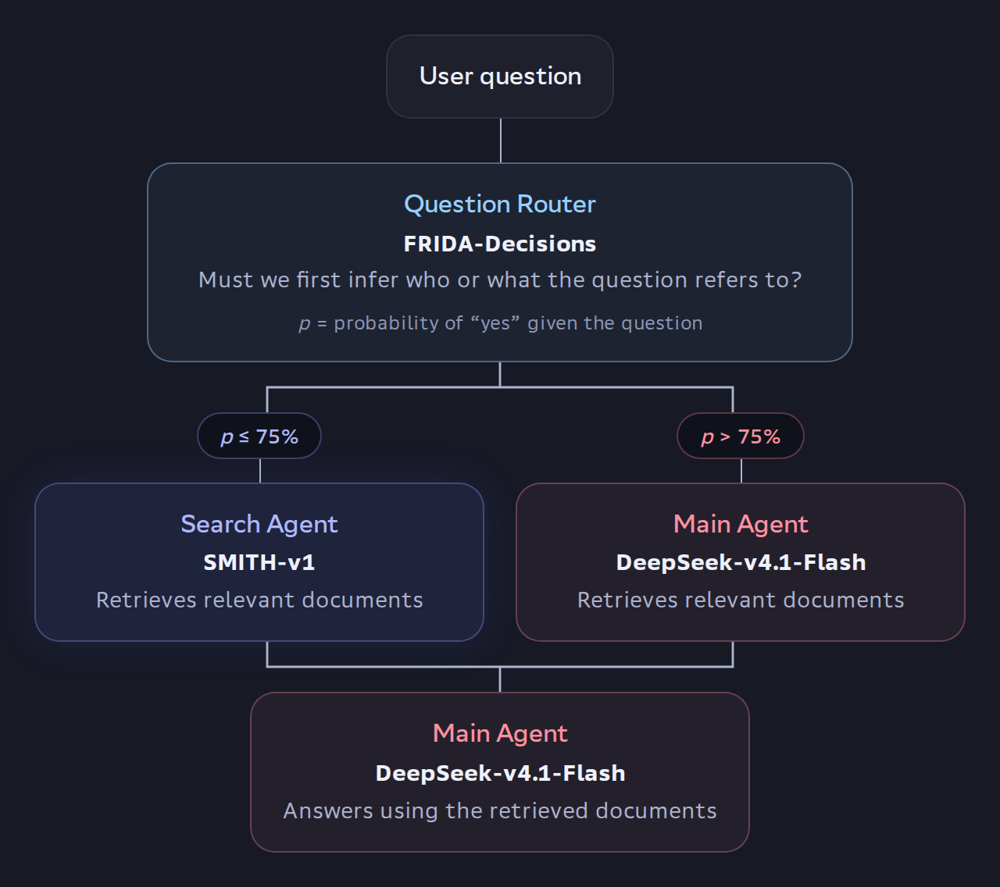
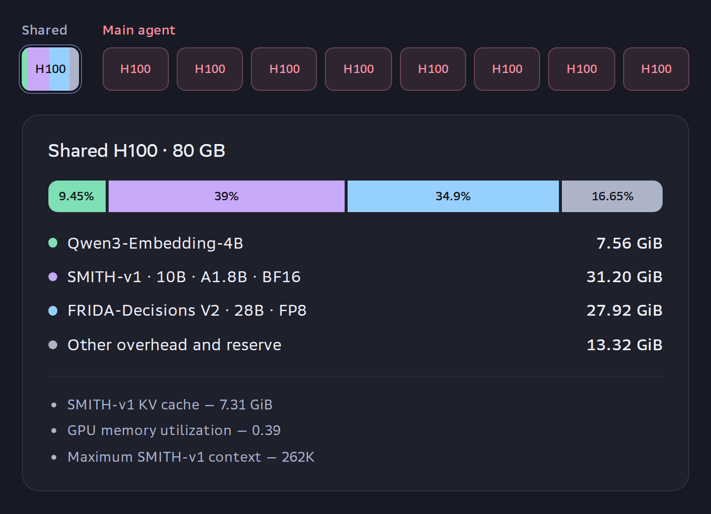

# Search Agent SMITH

**SMITH-v1** is a fast search agent that specializes in solving MultiHopQA and DeepResearchQA tasks. It tackles complex question topologies like those in [BrowseComp+ and TRuST](https://github.com/ai-forever/SMITH/blob/v1/README.md#metrics), as well as general complex queries in MuSiQue. It also shows strong performance on Russian-specific MultiHopQA benchmarks due to inherited large-scale pretraining on Russian language of the base model. It can be used either as a standalone agent or as a subagent that handles difficult QA tasks delegated by your main agent, freeing up capacity for other requests.

**SMITH-v1** is based on [**GigaChat 3.1 Lightning**](https://huggingface.co/ai-sage/GigaChat3.1-10B-A1.8B-bf16), a mixture-of-experts model with 10B total parameters and 1.8B active parameters. The BF16 serving configuration allocates **31.2 GiB of GPU memory** for a maximum context of **262,144 tokens**, including the KV cache.

## News

🔥 2026-11-28: [SMITH-v1](https://huggingface.co/ai-forever/SMITH-Exp/tree/v1) updates the retrieval checkpoint. Standalone Agent Recall@10 rose by 14.13 percentage points on BrowseComp-Plus and 7.75 points on TRuST on the shared evaluation cohorts. See [Metrics](#metrics) for standalone and routed retrieval results.

🎯 2026-09-17: [SMITH-Exp](https://huggingface.co/ai-forever/SMITH-Exp/tree/exp) was released on R&D Day. The original checkpoint and card are preserved under the `exp` tag, with a [matching harness](https://github.com/ai-forever/SMITH/tree/exp).

## Evaluation

We evaluate SMITH-v1 in two modes. As a standalone agent, SMITH-v1 handles every question. As a subagent, it handles only the questions routed to it. SMITH-v1 performs best when the question names the entity to look up. When some questions require the entity to be inferred from clues, we recommend using [**FRIDA-Decisions**](https://huggingface.co/ai-forever/FRIDA-Decisions) to route questions between SMITH-v1 and the main agent.

We report Recall@10 (%) across six benchmarks:

- [BrowseComp-Plus](https://huggingface.co/datasets/Tevatron/browsecomp-plus) — the full set of 830 questions.
- [TRuST](https://huggingface.co/datasets/t-tech/TRuST) — 324 questions about information from the Russian web.
- [MuSiQue](https://github.com/StonyBrookNLP/musique) — 300 questions stratified by hop count and topology. The sample has 100 questions each at two, three, and four hops. The three-hop and four-hop groups are split by topology in counts of 75/25 and 50/25/25, respectively.
- [DRAGON](https://huggingface.co/datasets/ai-forever/hist-rag-bench-private-qa/tree/1.15.0) — 100 hard questions.
- **Internal benchmark**
- [RUMBA](https://huggingface.co/datasets/ai-forever/RUMBA) — 157 hard questions from the Russian conversational memory benchmark.

## Metrics

| Model | Average | BrowseComp-Plus (full 830) | TRuST (full 324) | MuSiQue (strat 300) | DRAGON (hard 100) | Internal bench | RUMBA (hard 157) |
|---|---:|---:|---:|---:|---:|---:|---:|
| DeepSeek V4.1 Flash | 68.1 | 65.4 | 46.3 | 77.1 | 61.5 | 67.3 | 90.8 |
| DeepSeek V4.1 Flash &nbsp;+ FRIDA‑Decisions &nbsp;+ SMITH‑v1\*\* | 68.6 (44.2%) | 61.2 (18.1%) | 44.3 (17.6%) | 78.8 (21.3%) | 65.7 (82.0%) | 71.4 (81.0%) | 90.5 (100%) |
| SMITH-v1 | 62.5 | 41.3 | 27.7 | 79.5 | 63.2 | 72.7 | 90.5 |
| SMITH-Exp | 58.1 | 27.6 | 19.9 | 79.7 | 64.5 | 67.8 | 89.2 |
| Embedder single-shot\* | 42.5 | 20.7 | 13.1 | 54.6 | 32.0 | 58.1 | 76.4 |

\* Embedding models used by the baseline and retrieval agents.

- [**Qwen3-Embedding-8B**](https://huggingface.co/Qwen/Qwen3-Embedding-8B) — BrowseComp-Plus and TRuST.
- [**Qwen3-Embedding-4B**](https://huggingface.co/Qwen/Qwen3-Embedding-4B) — MuSiQue, DRAGON, and the internal benchmark.
- [**ai-forever/FRIDA**](https://huggingface.co/ai-forever/FRIDA) — RUMBA, following the [original paper](https://arxiv.org/html/2607.21447v1#S4.SS1).

\*\* FRIDA-Decisions routes a question to SMITH-v1 when its “yes” probability is 0.75 or lower, and to DeepSeek otherwise. Percentages in parentheses show the share of questions routed to SMITH-v1. In the Average column, Recall@10 weights the six datasets equally, while the routing share counts all 2,383 questions equally (1,054 routed to SMITH-v1).

## Usage

See [AGENTS.md](AGENTS.md) to integrate the harness with your search backend and model server. Use the [FRIDA-Decisions router](decisions_router/) to route retrieval between SMITH-v1 and a main agent.

For model weights, serving dependencies, and Transformers and vLLM examples, see [Usage in the Hugging Face model card](https://huggingface.co/ai-forever/SMITH-Exp/blob/v1/README.md#usage).

When pairing SMITH-v1 with the main agent, we recommend serving the compact mixture-of-experts model on the same GPU as the embedder when memory permits. In the example below, the main agent runs on eight H100s. A separate 80 GB H100 hosts Qwen3-Embedding-4B, SMITH-v1, and the router, with 31.2 GiB allocated to SMITH-v1 including its KV cache.

## Authors

- Anton Chernov ([GitHub](https://github.com/tony-pitchblack))
- Vladislav Leshchuk ([GitHub](https://github.com/srosy2))
- Artemiy Slepov ([GitHub](https://github.com/necoarcreator))
- Anastasia Goroshuk ([GitHub](https://github.com/agoroschuk))
- Artem Snegirev ([GitHub](https://github.com/artemsnegirev))

## License

Licensed under the [Apache License 2.0](LICENSE).
